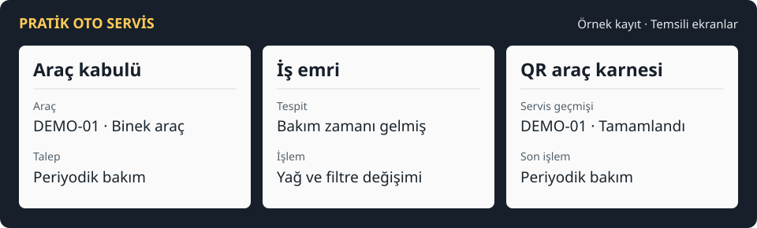

# Pratik Oto Servis

When a vehicle returns to our family’s workshop in Adana, the first question is often “What did we do last time?” I built our service management app to keep the intake request, technician’s findings and completed work together in the vehicle’s history.

*Illustrative screens with fictional records. The labels are in Turkish, the language we use in the workshop.*

| Stage | What happens in this example |
| --- | --- |
| Vehicle intake | The service desk opens a routine maintenance request for **DEMO-01**. |
| Work order | The technician records that maintenance is due and logs the oil and filter change. |
| Vehicle history | At the next visit, the vehicle’s QR record brings up the completed maintenance job. |

Built with Next.js, React, TypeScript, Tailwind CSS and Supabase (PostgreSQL).

## Atölyeden bir örnek

Araç kabulünde müşterinin talebiyle başlayan kayıt, teknisyenin tespiti ve yaptığı işlemle tamamlanıyor. Aynı araç tekrar geldiğinde QR araç karnesinden geçmişi açıp önceki bakımda hangi işlemlerin yapıldığını görebiliyoruz. Yukarıdaki temsili ekranlar bu akışı tek bir kurgu araç üzerinden gösteriyor.
